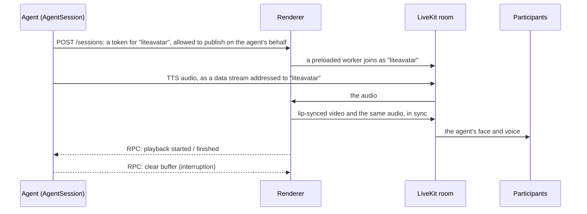

# livekit-lite-avatar

[](https://github.com/muhammaddevops/livekit-lite-avatar/actions/workflows/ci.yml)
[](LICENSE)


A lip-synced video avatar for [LiveKit Agents](https://github.com/livekit/agents) that you host yourself, on CPU:
no GPU, no avatar vendor and no per-minute fees. It plugs into an `AgentSession` the way LiveKit's hosted avatar
plugins do (Tavus, Hedra, Simli and others) and draws the face with Alibaba's
[LiteAvatar](https://github.com/HumanAIGC/lite-avatar) models.

<p align="center">
  <br>
  <sub>Recorded from a participant in a live LiveKit call, drawn on a laptop's CPU. <a href="docs/demo.mp4">With sound</a>.</sub>
</p>

```python
from livekit_lite_avatar import LiteAvatarSession

avatar = LiteAvatarSession(renderer_url="http://127.0.0.1:8791")
await avatar.start(session, room=ctx.room)
```

- **Drop-in.** The same shape as the hosted avatar plugins. The renderer reports when each reply really starts and
  stops playing, so the agent's speaking state, transcription timing and interruptions follow the avatar.
- **Fast enough on a laptop or a small VM.** An Apple M4 Pro draws 576x792 at 25 fps in under 40% of real time. A
  4-vCPU x86 cloud VM keeps up too. Speech reaches participants about 0.4 s after `say()`.
- **Degrades gracefully.** On a CPU too slow for real time, the voice stays whole and smooth and late frames are
  skipped. Each worker measures the machine at startup and suggests a frame rate. If the avatar leaves mid-call,
  the agent carries on with its own voice.
- **Tested end to end.** CI runs a real `AgentSession`, the renderer and a measuring viewer on a local LiveKit
  server, on Linux x86, Linux ARM and macOS.

Status: alpha. Read [Licences](#licences) before any commercial use: LiteAvatar's face weights and presenters have no
stated licence.

## Try it without any accounts or keys

```bash
git clone https://github.com/muhammaddevops/livekit-lite-avatar.git && cd livekit-lite-avatar
scripts/setup-renderer.sh        # Python 3.10 venv, plus LiteAvatar's code, weights and presenters (~1.3 GB)
brew install livekit             # the open-source LiveKit server; on Linux: curl -sSL https://get.livekit.io | bash
.venv/bin/python examples/local_demo/run.py
```

The demo starts a private LiveKit server with throwaway keys, the renderer and a small agent, and opens a page in
your browser. The agent needs no speech-to-text, LLM or text-to-speech: it greets you with three recorded lines,
then repeats whatever you say into your microphone, lip-synced. Your voice takes the same path a TTS reply would.
Add `--presenter sample` for the presenter in the clip above.

## Use it in your agent

**1. Run the renderer.** After `scripts/setup-renderer.sh`:

```bash
.venv/bin/liteavatar-renderer render        # optional offline check: WAV in, MP4 out, real-time factor
.venv/bin/liteavatar-renderer serve         # http://127.0.0.1:8791
```

`serve` loads a worker straight away (about 7 s on an M4 Pro), so the first session doesn't wait for models, and
keeps one spare loaded. Or run the [Docker image](#docker).

**2. Install the package where your agent runs.** It is small and doesn't need torch:

```bash
pip install "livekit-lite-avatar @ git+https://github.com/muhammaddevops/livekit-lite-avatar.git"
```

**3. Start the avatar with your session.**

```python
from livekit.agents import AgentSession, JobContext
from livekit_lite_avatar import LiteAvatarError, LiteAvatarSession

async def entrypoint(ctx: JobContext) -> None:
    session = AgentSession(stt=..., llm=..., tts=..., vad=...)
    await ctx.connect()

    avatar = LiteAvatarSession(renderer_url="http://127.0.0.1:8791")
    try:
        await avatar.start(session, room=ctx.room)
    except LiteAvatarError:
        pass  # renderer not running or full: the agent carries on, voice only

    await session.start(agent=MyAgent(), room=ctx.room)
```

[`examples/agent.py`](examples/agent.py) is a complete agent (STT, LLM and TTS through LiveKit Inference).

`start()` returns once the avatar is in the room, and only then routes the agent's audio to it. It raises
`LiteAvatarError` if the renderer is unreachable or busy, or couldn't join the room (a bad LiveKit URL from the
renderer's side, for example), and then leaves everything as it was. If the avatar leaves later (the renderer
stopped, or the session time limit passed), the agent switches back to publishing its own voice.

| `LiteAvatarSession(...)` | Default | |
|---|---|---|
| `renderer_url` | `LITEAVATAR_RENDERER_URL` or `http://127.0.0.1:8791` | the renderer service |
| `presenter` | the renderer's default | any presenter installed on the renderer |
| `renderer_secret` | `LITEAVATAR_SECRET` | sent as `X-Renderer-Secret` |
| `avatar_participant_identity`, `avatar_participant_name` | `liteavatar`, `Avatar` | how the avatar appears in the room |
| `request_timeout` | 90 s | how long to wait for the renderer (up to 60 s for a free worker, 25 s to join) |

`start()` also takes `livekit_url`, `livekit_api_key` and `livekit_api_secret`, which otherwise come from the usual
`LIVEKIT_*` variables.

**4. Turn off adaptive stream in the browser.** The renderer publishes one full-quality layer, and adaptive stream
would scale or pause it to fit the video element:

```js
const room = new Room({ adaptiveStream: false });          // livekit-client
<LiveKitRoom options={{ adaptiveStream: false }} ... />     // @livekit/components-react
```

## How it works



The agent side uses LiveKit's own `DataStreamAudioOutput`, the mechanism the hosted avatar plugins use. Each
renderer worker is one process serving one session:

1. Incoming audio is resampled to 16 kHz incrementally.
2. Paraformer speech features are computed for 1 s windows with 1 s of left context and 0.5 s of lookahead.
3. audio2mouth turns each window into 32 mouth parameters per frame. Windows overlap and are cross-faded,
   smoothed with a zero-phase low-pass, eased to a neutral mouth in pauses, and resampled from 30 to 25 fps on one
   continuous timeline.
4. The presenter's face decoder draws the mouth area, which is blended into the presenter's idle video.
5. LiveKit's `AVSynchronizer` publishes video and audio together. Between replies, the presenter's idle loop
   plays.

Each window is 1 s of speech plus 0.5 s of lookahead, and windows advance by 0.8 s, so a reply starts drawing once
1.6 s of its audio has arrived (the first window, its lookahead and a 0.1 s margin). Most TTS runs well ahead of real time, so that is almost at once, and
the first frames are ready about 0.3 s later. With TTS that streams only at real-time pace, the reply starts about
1.6 s after its first audio and then keeps up without skipping. If drawing does fall behind (a slow CPU), the next
audio plays over the last picture and the frames it missed are skipped, so the voice never waits for the face.

## Performance

The real-time factor is drawing time divided by speech length: below 1 the renderer keeps up. A live call wants
about 0.6 or less, leaving room for video encoding, the agent and anything else on the machine.

| Machine | Real-time factor | First sound after `say()` | New lip pictures per second (of 25) |
|---|---|---|---|
| Apple M4 Pro laptop, 14 cores (6 threads) | 0.37 | 0.45 s | 23.2 |
| Linux x86 CI runner, AMD EPYC 9V45, 4 vCPU (3 threads) | 0.63 | 0.42 s | 22.9 |
| Linux ARM CI runner, 4 vCPU (3 threads) | 1.15 | 0.86 s | 12.5 |
| macOS CI runner, Apple M1 (virtual), 3 vCPU (2 threads) | 1.61 | 1.78 s | 12.8 |

All from `scripts/benchmark.py`: 22 s of speech rendered offline, then the same speech in a live call on a local
LiveKit server, measured by a viewer. In every row all the speech arrived intact. On the slower machines the lips
moved at the rate frames could be drawn, with the voice unaffected. Lip pictures fall a little short of 25 even on
the M4 Pro, because the mouth rests in pauses. The CI runners share their CPUs with the LiveKit server, the agent
and the viewer, and GitHub assigns different CPU models from run to run. Each
[CI run](https://github.com/muhammaddevops/livekit-lite-avatar/actions/workflows/ci.yml) summary shows its own
benchmark and profile. On the M4 Pro, live calls with the LLM, agent and browser on the same laptop measured 0.44
to 0.47 with LiteAvatar's own decoder.

Most of the time goes on the presenter's face decoder, which draws each frame's mouth. LiteAvatar ships it as
TorchScript; the renderer rebuilds the same network from its weights (identical output, to within 1e-5) and runs it
in ONNX Runtime, which is much faster on CPU:

| Face decoder, ms per frame | Apple M4 Pro | Linux x86 runner (EPYC 7763) | Linux ARM runner | macOS M1 runner |
|---|---|---|---|---|
| LiteAvatar's TorchScript | 10.7 | 73.6 | 61.9 | 42.8 |
| ONNX Runtime (default) | 8.1 | 24.5 | 21.4 | 25.5 |

(One CI run, both decoders with the same threads: 6 on the M4 Pro, 4 on the Linux runners, 3 on the M1.)

Per second of speech, the rest is speech features (120 ms on the M4 Pro) and audio2mouth (10 ms). The decoder's cost
is per frame, so a lower `--fps` is the main lever on slower machines. `LITEAVATAR_DECODER=torch` uses LiteAvatar's
own decoder.

**Will it run on my machine?**

- Run `.venv/bin/python scripts/benchmark.py`. It renders 20 s offline, then makes a live call on a local
  LiveKit server and prints a table. Results for CPUs not listed here are welcome, through the issue form.
- The renderer estimates its own speed as each worker loads. It logs a warning with a suggested `--fps` if the
  machine can't keep up, and shows the estimate in `GET /health`.
- Each worker leaves one core free by default (`LITEAVATAR_THREADS`). On a machine that only runs the renderer
  and serves one session at a time, set it to the number of cores.

## Configuration

The renderer reads `LITEAVATAR_*` environment variables, and command-line flags to `liteavatar-renderer serve`
override them. The server passes its settings on to every worker it starts.

| Setting | Variable | Flag | Default | Notes |
|---|---|---|---|---|
| Frame rate | `LITEAVATAR_FPS` | `--fps` | 25 | the main lever on slower CPUs; 30 is smoother for ~10% more CPU |
| Face decoder | `LITEAVATAR_DECODER` | `--decoder` | `onnx` | `torch`: LiteAvatar's own TorchScript (slower) |
| Width | `LITEAVATAR_WIDTH` | `--width` | 576 | height follows the presenter |
| Threads | `LITEAVATAR_THREADS` | `--threads` | 6, or one fewer than the cores | per worker, for torch and ONNX Runtime |
| Lip delay | `LITEAVATAR_LIP_DELAY_FRAMES` | `--lip-delay-frames` | 1 | video starts this many frames after its audio |
| Bitrate | `LITEAVATAR_BITRATE` | `--bitrate` | 2500000 | one video layer, no simulcast |
| Presenter | `LITEAVATAR_PRESENTER` | `--presenter` | `P1yerb8kIA7eBpaIydU2lwzA` | for sessions that don't ask for one |
| Sessions | `LITEAVATAR_MAX_SESSIONS` | `--max-sessions` | 2 | one worker process each |
| Warm workers | `LITEAVATAR_WARM_WORKERS` | `--warm-workers` | 1 | preloaded spares, within the session limit |
| Refill delay | `LITEAVATAR_REFILL_DELAY_S` | `--refill-delay-s` | 60 | before preloading the next worker (skipped when a session is waiting) |
| Session limit | `LITEAVATAR_MAX_SESSION_S` | `--max-session-s` | 1800 | a worker leaves after this long |
| Address | `LITEAVATAR_HOST`, `LITEAVATAR_PORT` | `--host`, `--port` | 127.0.0.1, 8791 | |
| Secret | `LITEAVATAR_SECRET` | | none | if set, requests need a matching `X-Renderer-Secret` |
| Data folder | `LITEAVATAR_HOME` | `--home` | `~/.cache/livekit-lite-avatar` | LiteAvatar's code, weights and presenters |

`GET /health` returns the number of ready, loading and active workers, the installed presenters and the speed
estimate. It answers 503 when workers keep failing to load, so a container health check catches a broken setup.

## Presenters

The presenters are Alibaba's: LiteAvatar has no public tool to make one from your own photo or video. `setup`
installs the default presenter from ModelScope's
[LiteAvatarGallery](https://modelscope.cn/models/HumanAIGC-Engineering/LiteAvatarGallery) (checked against a
known SHA-256, like the weights) and `sample`, the presenter that comes with LiteAvatar's code.

```bash
.venv/bin/liteavatar-renderer setup --presenter <id> [--gallery 20250408]   # more from the gallery
.venv/bin/liteavatar-renderer presenters                                    # list installed ones
```

A session can ask for any installed presenter, with `LiteAvatarSession(presenter="<id>")`. The preloaded worker
switches in about a second.

## Deploying

**Placement.** The renderer needs to reach your LiveKit server (LiveKit Cloud or self-hosted), and your agent needs
to reach the renderer over HTTP. They can share a machine or not. A worker is a separate process per session and
keeps up to 6 cores busy while the avatar talks. Two sessions at once is the default limit and what an M4 Pro was
sized for; scale out with more machines, each with its own renderer.

**Security.** The renderer binds to localhost by default. If you expose it, set `LITEAVATAR_SECRET` (and the same
secret on the agent side), and keep it behind a firewall: the secret is its only authentication.

### Docker

```bash
docker build -t livekit-lite-avatar-renderer .
docker run -p 8791:8791 -v liteavatar-data:/data -e LITEAVATAR_SECRET=change-me livekit-lite-avatar-renderer
```

The image is CPU only and runs as a non-root user. LiteAvatar's assets aren't baked in (see
[Licences](#licences)): the first start downloads them into `/data`, so keep that on a volume.

## Streaming quality and lip timing

These defaults come from live calls. What reaches the browser matters more than the renderer's own settings.

- **One video layer, about 2.5 Mbps.** With LiveKit's defaults (simulcast plus the client's adaptive stream), a
  smaller video element got a 360x495 copy at about 20 fps. That looked softer and choppier, and choppy lips read
  as out of sync. The renderer publishes a single layer, and clients should turn adaptive stream off.
- **Lip delay of one frame.** LiteAvatar's lips run about 40 ms ahead of other lip-sync models on the same clips,
  so each reply's video starts one frame (40 ms at 25 fps) after its audio.
- **First frames early.** A reply's first window is computed alone, and its first two frames are handed over at
  once, before the rest are drawn.
- **Recovering from a broken stream.** If LiveKit's audio stream to the renderer breaks mid-reply (seen once:
  "expected chunk index to be exactly one more than the previous"), the worker ends that reply and opens a fresh
  receiver, so the next reply plays normally.

## Tuning

These are off by default, because in a live call they looked worse overall. Try them offline first, for example
`liteavatar-renderer render speech.wav out.mp4 --open-gain 1.8`.

| Setting | Effect |
|---|---|
| `LITEAVATAR_OPEN_GAIN=1.8` | Opens the mouth wider. audio2mouth's 32 parameters move mostly along one direction (70% of the variance: the jaw opening), and this scales only that direction, without artefacts. On an English test clip, lip movement rose from 5.0 to 7.3% of face height, with closures on m, b and p still at 100%. |
| `LITEAVATAR_MOUTH_GAIN` | Scales every mouth parameter. Leaves white specks and smears from about 1.3. |
| `LITEAVATAR_HEAD_MOTION=1.8` | A gentle sway, a slight lean-in while talking and small nods, by moving the whole frame about a point at chest height. Softens the picture; above about 2.5 it reads as a moving camera. |
| `LITEAVATAR_SMOOTH_HZ` | Low-pass on the mouth parameters (10 Hz, LiteAvatar's own). 14 Hz made no measurable difference. |

## Limits

- **Mouth only.** LiteAvatar redraws the mouth area; the rest is the presenter's idle video, looped. There are no
  head turns or gestures.
- **CPU-bound.** Small cloud VMs don't keep up at 25 fps: the voice stays smooth, and the lips move at the rate
  frames can be drawn. See [Performance](#performance).
- **Startup.** A worker takes from about 7 s (M4 Pro) to a minute to load, which is why one is kept warm. If none
  is free, the renderer waits up to 60 s for one, then the agent gets a `LiteAvatarError`.
- **Versions.** The agent side needs `livekit-agents` 1.8.x. The renderer pins 1.8.11, because it builds on some
  of its internals: `AvatarRunner`'s publishing (to send a single layer), the data-stream receiver, and RoomIO's
  audio output for the fall-back to voice. The stream wrapper calls LiteAvatar's internals, so LiteAvatar is pinned
  to a tested commit. The renderer runs on Python 3.10 (3.11 and 3.12 should work, untested).
- **Separate process.** The renderer changes into LiteAvatar's folder while importing it, because LiteAvatar loads
  its weights from relative paths. Run it as its own process, as `serve` does, not inside your agent.

## Development

```bash
.venv/bin/pytest          # unit tests, offline renders, and live end-to-end runs on a local livekit-server
```

The live tests start the open-source `livekit-server` with throwaway keys, the renderer, an agent worker that
registers and is dispatched like a production agent, and a viewer that measures what a participant receives:
- who publishes, and whether simulcast is off;
- frame rate, new lip pictures per second, and the longest gap between frames;
- whether all the speech arrives;
- how soon it starts;
- how quickly an interruption silences it;
- whether the agent's voice carries on when the avatar is removed mid-call.

Offline tests play the worker's output at real-time pace in four situations: TTS faster than real time, TTS at
real-time pace, a CPU too slow for real time, and a reply right after an interruption. In each, the reply's audio
must come out bit-identical and without a pause. The server is tested against fake workers that load, fail to join,
or die while loading. Another test drives the browser demo's agent with a synthetic microphone. See
[CONTRIBUTING.md](CONTRIBUTING.md) for more.

## Licences

This project's code is licensed under the Apache License 2.0 (see `LICENSE`). It downloads, but does not include,
LiteAvatar's parts, whose licences differ:

| Part | Where it comes from | Licence |
|---|---|---|
| LiteAvatar code | GitHub [HumanAIGC/lite-avatar](https://github.com/HumanAIGC/lite-avatar) | MIT |
| The `sample` presenter | the same repository (`data/sample_data.zip`) | the repository is MIT; nothing separate stated |
| Paraformer speech model (`model.pb`, `lm.pb`) | ModelScope [iic/speech_paraformer-large…](https://modelscope.cn/models/iic/speech_paraformer-large_asr_nat-zh-cn-16k-common-vocab8404-pytorch) (fetched from LiteAvatarGallery) | Apache-2.0 |
| Face weights `model_1.onnx` and the gallery presenters | ModelScope [HumanAIGC-Engineering/LiteAvatarGallery](https://modelscope.cn/models/HumanAIGC-Engineering/LiteAvatarGallery) | **none stated** |

No licence means no permission by default. A public question asking whether the weights are covered by the MIT
licence ([lite-avatar issue #27](https://github.com/HumanAIGC/lite-avatar/issues/27), June 2026) had no answer as
of November 2026. Check upstream, or get written permission from Alibaba, before using `model_1.onnx` or the
presenters commercially. The `sample` presenter ships inside the MIT-licensed repository, but whether that licence
is meant to cover it isn't stated either. This is not legal advice.

Other files in this repository:
- `docs/demo.*` and `examples/local_demo/audio/` use the `sample` presenter and a voice made with
  [Kokoro](https://huggingface.co/hexgrad/Kokoro-82M) (Apache-2.0).
- `src/livekit_lite_avatar/renderer/mouth_pcs.npy` holds four 32-value vectors, used by `LITEAVATAR_OPEN_GAIN`.
  This project computed them from audio2mouth's output on test speech; they contain no LiteAvatar weights.

## Acknowledgements

[LiteAvatar](https://github.com/HumanAIGC/lite-avatar) by Alibaba's HumanAIGC team, which builds on
[Paraformer](https://modelscope.cn/models/iic/speech_paraformer-large_asr_nat-zh-cn-16k-common-vocab8404-pytorch)
and [FunASR](https://github.com/modelscope/FunASR); [LiveKit Agents](https://github.com/livekit/agents), whose
avatar data-stream and A/V sync classes this builds on; and [Kokoro](https://huggingface.co/hexgrad/Kokoro-82M) for
the demo's voice.
